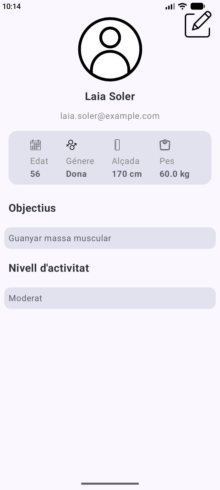
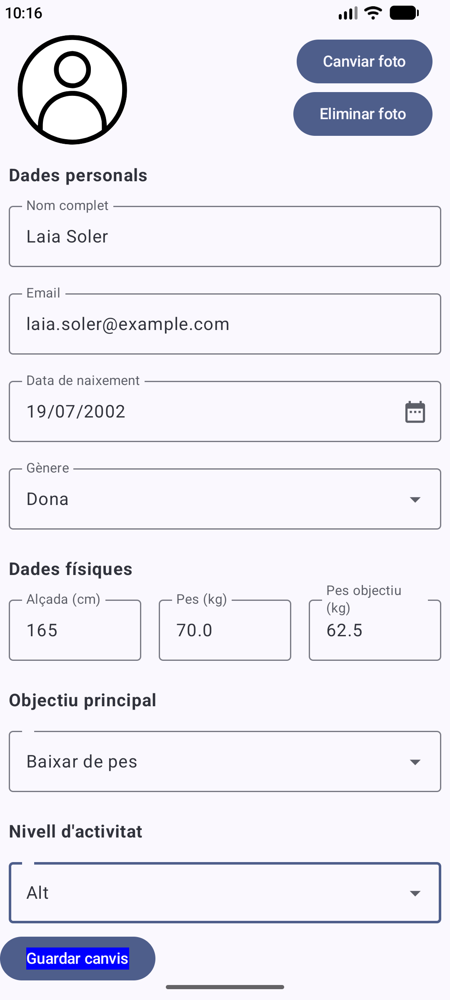

# 🏋️‍♂️ Fitness App - Pàgina de Perfil

Aplicació Android de fitness desenvolupada amb **Kotlin** i **Jetpack Compose** que permet consultar i modificar la informació personal de l'usuari. 
Aquesta primera fase se centra en la creació de les pantalles de perfil i edició de perfil, treballant amb dades locals.
## 📋 Descripció

El projecte implementa dues pantalles principals:
- **ProfileScreen**: mostra la fotografia de perfil, el nom, el correu electrònic, les dades físiques i els objectius de l'usuari.
- **EditProfileScreen**: permet modificar aquestes dades mitjançant camps de text, botons i menús desplegables.

## ✨ Funcionalitats

- Visualització de les dades inicials de l'usuari (Laia Soler).
- Edició del nom, pes i objectiu mitjançant formularis.
- Navegació bàsica entre les pantalles de perfil i edició.

## 🛠️ Tecnologies utilitzades

- **Llenguatge**: Kotlin
- **UI**: Jetpack Compose
- **Components**: `@Composable`, `Column`, `Row`, `Text`, `Card`, `Button`, `OutlinedTextField`
- **Navegació**: Navegació bàsica entre composables
- **Gestió d'estat**: `remember` i `mutableStateOf`

## 📸 Captures de pantalla

| ProfileScreen | EditProfileScreen | ProfileScreenChanges |
| :---: | :---: |
|  |  |
